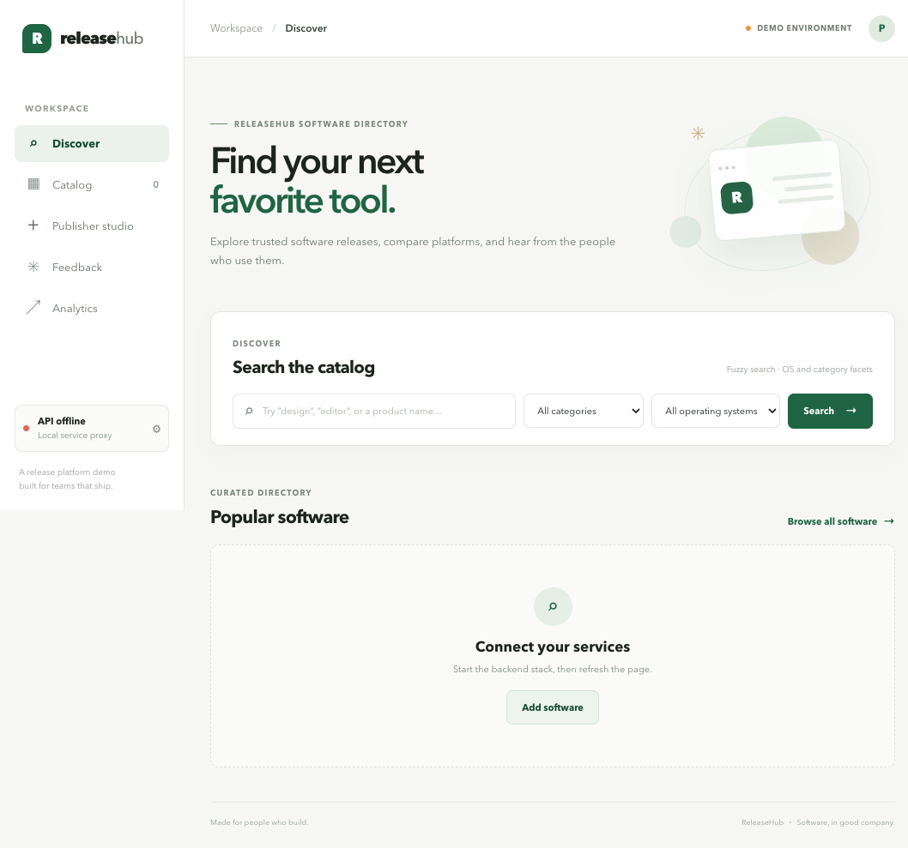

# ReleaseHub demo client

A minimal React/Vite UI for exercising the ReleaseHub catalog, search, feedback,
analytics, and publisher APIs.

## Screenshot



## Run locally

Start the backend stack from the repository root, then run:

```bash
npm install
npm run dev
```

Open `http://localhost:5173`. Vite proxies `/api/catalog`, `/api/search`,
`/api/feedback`, and `/api/reports` to the local services on ports 8083–8086.
Use **API settings** in the sidebar to configure a gateway URL, bearer token,
publisher/admin role, or user ID.

## Features

- Discover: fuzzy search, category/OS filters, and facets.
- Catalog: browse products, inspect releases, download, and manage entries.
- Publisher studio: create products, publish releases, and rebuild the search index.
- Feedback: submit ratings and comments, then browse reviews.
- Analytics: view download, rating, and feedback totals by product.

## Project layout

```text
src/
├── assets/                 # Global styles
├── components/             # Shared navigation and API settings
├── config/                 # Central API client
├── features/               # Catalog, search, publisher, feedback, and reports
├── hooks/                  # Shared identity/API settings hook
└── routes/                 # Feature-page selection
```

Run `npm run build` to create the production bundle and `npm run lint` to check
the client source.
