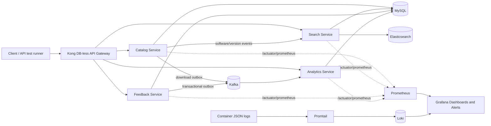

# ReleaseHub Architecture

## Data flows

- **Catalog and search:** Catalog writes software/version records to MySQL and emits application events. Search maintains the Elasticsearch index and serves fuzzy/faceted queries. Reindexing writes to a versioned index and swaps the `software` alias.
- **Feedback and downloads:** A feedback submission or download records its event in the same MySQL transaction as the business change. The scheduled outbox relay publishes to Kafka; analytics consumers deduplicate events and update report aggregates. Failed consumer records are sent to the corresponding dead-letter topic after retries.
- **Gateway:** Kong routes `/api/catalog`, `/api/search`, `/api/feedback`, and `/api/reports`; its JWT, CORS, rate-limit, and correlation-ID plugins apply to gateway traffic. Direct service ports in the local Compose profile exist for the API test scripts and local debugging.
- **Observability:** Spring Actuator exports Micrometer metrics to Prometheus. Grafana provisions the overview dashboard and Prometheus/Loki data sources. Promtail collects Docker logs for Loki; request correlation IDs are included in structured application logs.

## Deployment notes

`infra/docker-compose.yml` is the reproducible local stack. The Kubernetes resources under `infra/k8s/` deploy the application and Kong and expect MySQL, Elasticsearch, and Kafka endpoints to be available at the hostnames configured in `releasehub-config`. Supply credentials as a Kubernetes Secret and configure a Kong JWT consumer with the public key corresponding to the private signing key; never commit private keys or production credentials.
